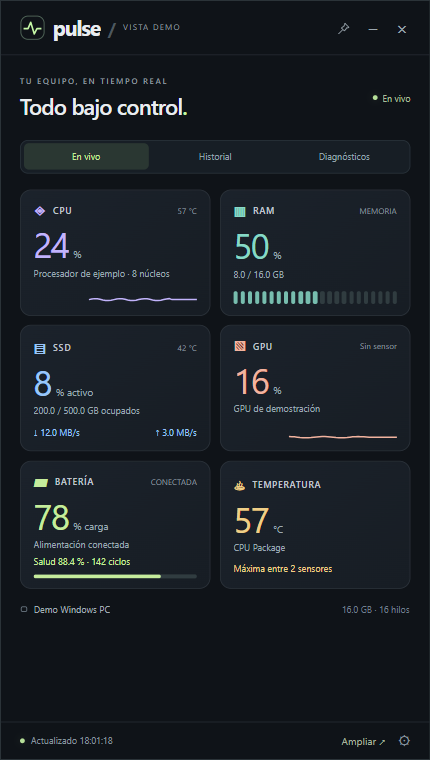

# Pulse System Monitor

[](LICENSE)
[](https://github.com/arturhc/pulse-system-monitor/releases)

**Un widget de escritorio para ver qué está pasando dentro de tu computadora.** CPU, RAM, almacenamiento, GPU, batería, temperaturas, historiales y diagnósticos, en una interfaz compacta que puedes mantener sobre tus otras ventanas.

*A Windows desktop system monitor with a web UI, local history, battery health and hardware diagnostics. The application and documentation are currently in Spanish.*



> La captura usa datos de demostración. El repositorio no contiene historiales, reportes ni identificadores de una computadora real.

## Qué incluye

| Función | Qué muestra o guarda |
| --- | --- |
| CPU | Utilización global, núcleos/hilos detectados, frecuencias y temperaturas disponibles |
| RAM | Memoria física usada, disponible y total |
| Almacenamiento | Actividad y transferencia agregadas de discos físicos, espacio de la unidad del sistema y sensores NVMe disponibles |
| GPU | Utilización del motor más ocupado y memoria compartida cuando el proveedor la expone |
| Batería | Carga, alimentación, autonomía informada, capacidad de diseño/completa, salud estimada, desgaste y ciclos |
| Temperaturas | Lecturas reales; excluye límites de advertencia, críticos y distancia a TjMax |
| Historial | Muestras cada 15–16 s durante 30 días; salud diaria de batería durante un año |
| Diagnósticos | Reporte de batería de Windows, memoria/espacio, estado expuesto del disco, SMART disponible y eventos seleccionados de hardware |
| Escritorio | Ventana movible, redimensionable, fijable, bandeja del sistema y opción de inicio con Windows |

## Descargar y usar

1. Abre [Releases](https://github.com/arturhc/pulse-system-monitor/releases/latest) y descarga `Pulse-System-Monitor-v1.2.0-win-x64.zip`.
2. Extrae **todo** el ZIP a una carpeta. El `.exe` necesita los archivos que lo acompañan.
3. Ejecuta `Pulse.exe` para uso portátil, o `Instalar Pulse.exe` para copiarlo a tu perfil y crear accesos en Inicio y Escritorio.
4. En **⚙ → Activar sensores avanzados**, autoriza Windows si necesitas sensores internos que no aparecen en modo estándar.

El ZIP es autocontenido: no necesitas instalar .NET por separado. Sí necesita **Microsoft Edge WebView2 Runtime**, que debe estar instalado. La plataforma validada es **Windows 11 x64**; no se han validado otros sistemas ni arquitecturas.

El monitoreo, historial y diagnóstico se ejecutan localmente y funcionan sin cuenta ni conexión. Si falta PawnIO, el botón de sensores avanzados descarga por HTTPS una versión oficial fijada y comprueba su SHA-256 antes de solicitar instalación. Esa descarga opcional sí requiere internet. No se omiten las confirmaciones de Windows.

## Cómo se usa

- Arrastra la barra superior para moverlo; arrastra la esquina inferior derecha para cambiar el tamaño.
- El botón de pin fija la ventana. **−** la oculta junto al reloj; doble clic en el icono la vuelve a mostrar. **×** sale y detiene el registro.
- **Ampliar** muestra los detalles. Las pestañas **Historial** y **Diagnósticos** abren sus vistas ampliadas.
- En **Historial**, elige 1 h, 24 h, 7 días o 30 días; **Exportar CSV** guarda las muestras y abre su carpeta.
- **Correr diagnóstico** crea un nuevo reporte HTML/JSON y el informe nativo de batería cuando Windows lo permite. También hay una revisión inicial por versión.
- **Iniciar con Windows** es opcional y comienza desactivado. Arranca en modo estándar; los sensores que requieren elevación deben activarse de nuevo.

### Carga de batería ≠ salud

Una carga de 100 % puede corresponder a una batería que ha perdido capacidad. Pulse calcula:

```text
salud (%) = capacidad de carga completa / capacidad de diseño × 100
desgaste (%) = max(0, 100 − salud)
```

Son estimaciones del controlador y pueden variar con calibración y temperatura. Las etiquetas de Pulse son orientativas: menos de 80 % se marca como desgaste; menos de 60 %, desgaste alto. Los ciclos se muestran solo si el equipo los informa. No se fuerza una descarga para medir autonomía.

## Compilar desde el código

Requisitos de desarrollo: Windows, **SDK .NET 10**, **Node.js 22+** para las pruebas de presentación y **PowerShell 7.2+** para los scripts.

```powershell
git clone https://github.com/arturhc/pulse-system-monitor.git
cd pulse-system-monitor
./scripts/build.ps1
./scripts/test.ps1 -SkipBuild
./scripts/package.ps1 -SkipBuild
```

El ejecutable queda en `artifacts/win-x64/`; el ZIP y su SHA-256, en `artifacts/packages/`. La restauración usa `packages.lock.json` en modo bloqueado. Los scripts de compilación y prueba no instalan controladores ni ejecutan el monitor sobre el hardware del runner.

Las pruebas se ejecutan localmente. Se incluye una [plantilla Windows CI](docs/ci/windows-ci.yml), que todavía no está activada en GitHub Actions: la credencial de publicación no dispone del permiso `workflow`. La [guía de desarrollo](docs/DEVELOPMENT.md#activar-github-actions) explica cómo habilitarla.

## Documentación

- [Instalación, actualización y solución de problemas](docs/INSTALLATION.md)
- [Arquitectura y fuentes de métricas](docs/ARCHITECTURE.md)
- [Historial, privacidad y esquema de datos](docs/DATA-AND-PRIVACY.md)
- [Alcance de los diagnósticos](docs/DIAGNOSTICS.md)
- [Desarrollo, pruebas y publicación](docs/DEVELOPMENT.md)
- [Cambios por versión](CHANGELOG.md)
- [Cómo contribuir](CONTRIBUTING.md) · [Seguridad](SECURITY.md)

## Límites conocidos

- La disponibilidad de temperaturas, ciclos, SMART, frecuencias y autonomía depende del hardware, firmware, permisos y controlador. Un dato ausente se muestra como tal.
- La actividad de disco se agrega entre unidades; el espacio mostrado corresponde a la unidad del sistema. No es un explorador individual de discos o GPUs.
- Las gráficas históricas agregan muestras por intervalo. Los periodos sin registro quedan como huecos; no se reconstruye el uso cuando Pulse estaba cerrado.
- Consultar sensores de almacenamiento puede despertar una unidad. Se consultan con menor frecuencia que CPU/RAM.
- Los diagnósticos son consultas y reportes, no una certificación de salud. No ejecutan pruebas de estrés, reparación, pruebas completas de memoria ni reinicios.
- La app y los ZIP de publicación no llevan firma de código propia. No desactives las protecciones de Windows para ejecutarlos; puedes revisar y compilar las fuentes.

## Licencia

Código original bajo [MIT](LICENSE). Las dependencias conservan sus condiciones; consulta [THIRD-PARTY-NOTICES.md](THIRD-PARTY-NOTICES.md). PawnIO se obtiene de su origen oficial únicamente cuando el usuario solicita los sensores avanzados; su instalador no se distribuye en este repositorio.
