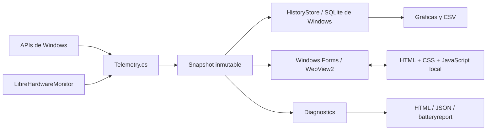

# Arquitectura

Pulse es una aplicación Windows nativa que aloja una interfaz web local. No hay servidor HTTP, backend remoto, cuenta ni servicio en la nube.

## Procesos e interfaz

`Program.cs` controla instancia única mediante mutex, instalación por usuario, bandeja, posición, tamaño, elevación y preferencias. WebView2 ejecuta sus propios procesos de interfaz/renderizado; no se empaqueta Electron ni se usa Tauri.

Los archivos de `ui/` se resuelven mediante un host virtual de WebView2. No se sirven por la red. El frontend envía comandos de una lista explícita (`pin`, `expand`, `history:24h`, `diagnostics`, etc.). El host responde con mensajes JSON tipados por `type`.

La navegación se limita al origen local, los enlaces que solicitan nuevas ventanas se bloquean y los permisos de WebView2 se deniegan. La política CSP permite scripts y estilos propios y bloquea conexiones del frontend. La descarga opcional del controlador ocurre en el host .NET, únicamente a solicitud del usuario.

## Fuentes y frecuencia

| Métrica | Fuente | Cadencia aproximada |
| --- | --- | --- |
| CPU global | Deltas de `GetSystemTimes` | 2 s |
| Memoria física | `GlobalMemoryStatusEx` | 2 s |
| Batería básica | `GetSystemPowerStatus` | 2 s |
| Actividad/transferencia de discos | Contadores `PhysicalDisk / _Total` | 2 s |
| GPU global | Contadores `GPU Engine`, agrupados por motor entre procesos; se toma el más ocupado | 2 s; catálogo de instancias cada ~10 s |
| Sensores, capacidades y frecuencias | LibreHardwareMonitor | 2 s |
| Sensores de almacenamiento | LibreHardwareMonitor | ~30 s |
| Identidad de equipo, núcleos/hilos y ciclos | Consultas WMI acotadas al inicio | Inicio |

`Telemetry` trabaja fuera del hilo de UI. Un `Snapshot` contiene números anulables y una copia de la lista de sensores. Una lectura fallida no se convierte en cero. El frontend marca la muestra como desactualizada tras ocho segundos sin actualización.

## Componentes

| Archivo | Responsabilidad |
| --- | --- |
| `Telemetry.cs` | Consultar hardware y normalizar muestras |
| `BatteryQuality.cs` | Capacidad, salud, desgaste y ciclos |
| `TemperatureRules.cs` | Separar temperaturas medidas de límites/umbrales |
| `HistoryStore.cs` | Esquema, muestreo, retención, consultas agregadas y CSV |
| `Diagnostics.cs` | Consultas de diagnóstico y reportes HTML/JSON |
| `Program.cs` | Ciclo de vida, instalación y puente WebView2 |
| `ui/app.js` | Lecturas en vivo y detalles |
| `ui/features.js` | Historial, salud y diagnósticos |
| `StorageTests.cs` | Pruebas aisladas de persistencia y reglas de datos |

No se utilizan datos de demostración en el monitor. La captura de documentación sí se genera con una muestra sintética claramente identificada.
